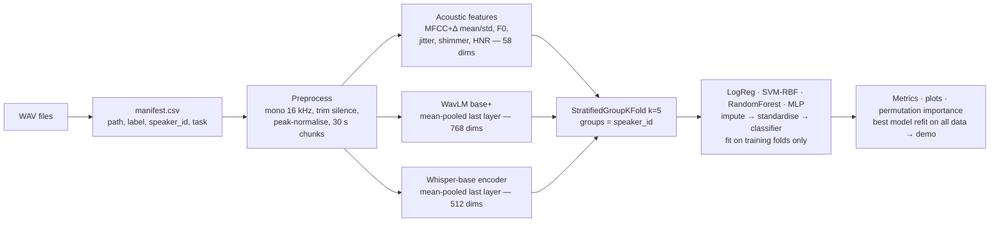
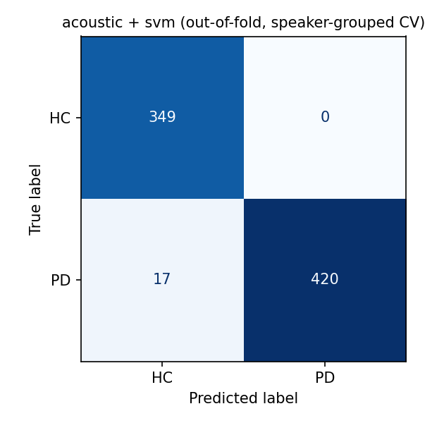
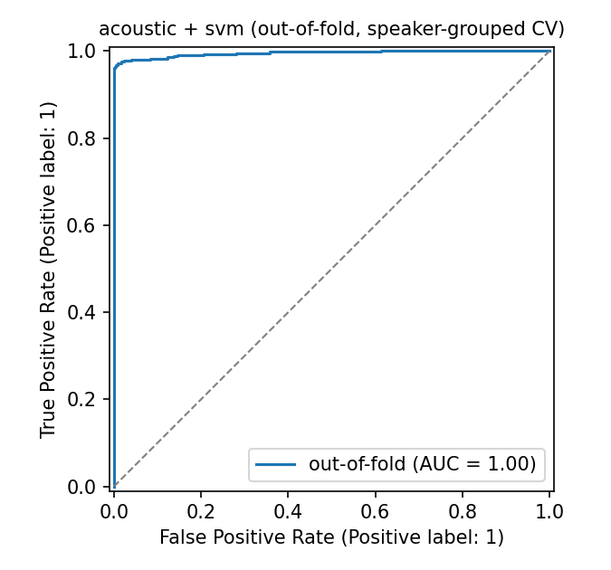
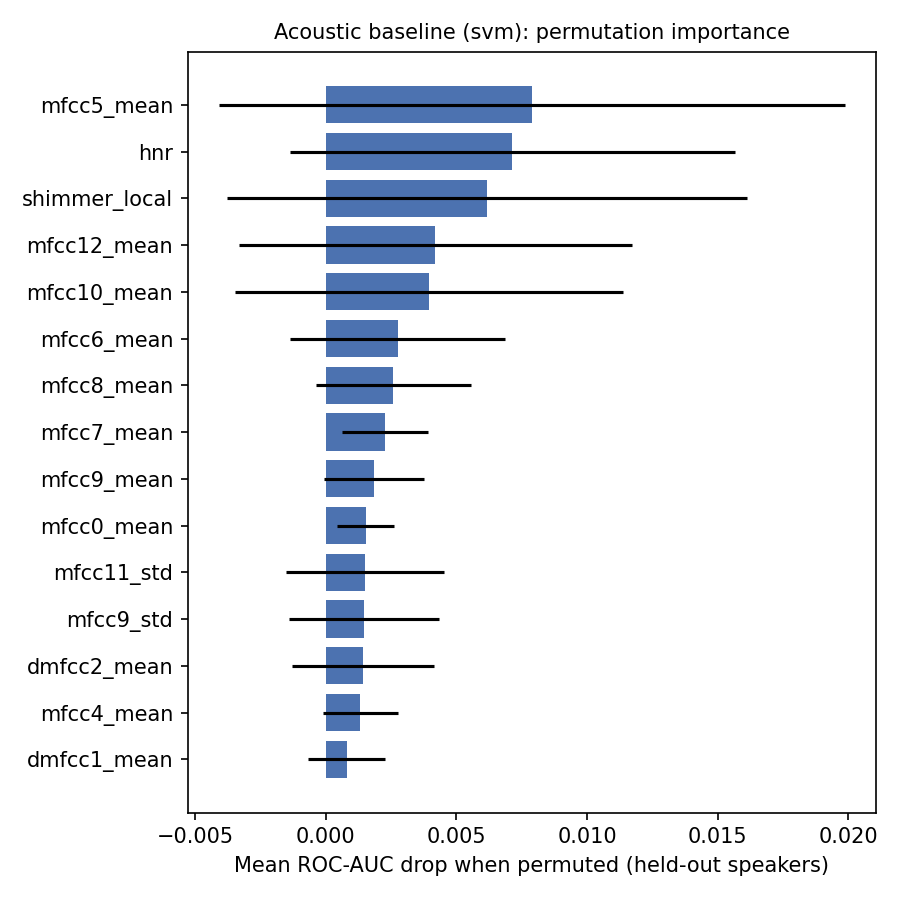

# Voice-Based Parkinson's Disease Screening

A reproducible machine-learning pipeline that screens for Parkinson's disease (PD) from voice recordings. It compares a classic acoustic-feature baseline (MFCCs, jitter, shimmer, HNR, F0) with self-supervised speech embeddings (WavLM, Whisper encoder). All models are evaluated with **speaker-independent** cross-validation. The repo includes a small Gradio demo.

**Live demo:** https://voice-parkinsons-screening.onrender.com (free tier: the first visit after idle can take ~1 min to wake)

> ⚠️ **Research prototype. Not a medical diagnosis.** This is not a diagnostic tool, it has not been clinically validated, and it must not be used to make health decisions.

---

## 1. Dataset

**Italian Parkinson's Voice and Speech** (Dimauro & Girardi, 2019), via Kaggle `ieeeai/italian-parkinsons-voice-and-speech`, CC BY 4.0. Full details are in [`docs/DATASET.md`](docs/DATASET.md).

| Group | Label | Speakers | Recordings |
|---|---|---|---|
| People with Parkinson's disease | PD | 24 | 437 |
| Elderly healthy controls | HC | 22 | 349 |
| Young healthy controls | *excluded* (age and task confound) | 15 | 45 |

Tasks: sustained vowels a/e/i/o/u (×2), syllable repetition "pa"/"ta", reading of a phonemically balanced text (×2), phrases, and words. The PD folder has 28 session folders but only 24 people: three patients were recorded in two or three sessions. Those sessions are merged into one speaker ID, so the same person never appears in both a training fold and a test fold.

Citation:
```bibtex
@data{aw6b-tg17-19, doi = {10.21227/aw6b-tg17}, author = {Dimauro, Giovanni and Girardi, Francesco},
  publisher = {IEEE Dataport}, title = {Italian Parkinson's Voice and Speech}, year = {2019}}
```
Please also cite Dimauro et al., *IEEE MeMeA 2016* (doi:10.1109/MeMeA.2016.7533761) and *IEEE Access* 5, 2017 (doi:10.1109/ACCESS.2017.2762475).

## 2. Method



- **No speaker leakage:** folds are grouped by speaker, and a hard assertion and a unit test check that no speaker is ever in both train and test.
- **No preprocessing leakage:** imputation and scaling live inside a scikit-learn `Pipeline`, fit on the training folds only.
- **Class imbalance:** `class_weight="balanced"` where supported. sklearn's MLP has no class weights, but the classes are close to balanced (56% PD).
- **SSL embeddings:** mean-pooled over valid frames; long clips are chunked and the chunk vectors averaged; cached to `.npy`.

## 3. Results (full run on Kaggle, T4 GPU)

All numbers below come from a single run of `notebooks/kaggle_run.ipynb` (kernel version 2): 786 recordings, 46 speakers, 5-fold speaker-grouped CV, seed 42. Each cell is the mean ± std over the 5 folds, at recording level. Raw files are in [`docs/results/`](docs/results/).

| Features | Model | Accuracy | Balanced acc. | F1 | Sensitivity | Specificity | ROC-AUC |
|---|---|---|---|---|---|---|---|
| acoustic | **svm** | 0.978 ± 0.035 | **0.977 ± 0.039** | 0.975 ± 0.044 | 0.953 ± 0.079 | 1.000 ± 0.000 | 0.994 ± 0.013 |
| acoustic | mlp | 0.976 ± 0.045 | 0.974 ± 0.049 | 0.972 ± 0.056 | 0.957 ± 0.090 | 0.991 ± 0.013 | 0.988 ± 0.026 |
| acoustic | logreg | 0.970 ± 0.042 | 0.968 ± 0.046 | 0.967 ± 0.053 | 0.951 ± 0.087 | 0.985 ± 0.018 | 0.987 ± 0.030 |
| acoustic | rf | 0.937 ± 0.065 | 0.932 ± 0.066 | 0.935 ± 0.077 | 0.935 ± 0.081 | 0.929 ± 0.063 | 0.980 ± 0.030 |
| wavlm | logreg | 0.928 ± 0.036 | 0.921 ± 0.040 | 0.926 ± 0.046 | 0.903 ± 0.082 | 0.939 ± 0.053 | 0.958 ± 0.033 |
| wavlm | svm | 0.920 ± 0.050 | 0.913 ± 0.058 | 0.923 ± 0.054 | 0.930 ± 0.072 | 0.896 ± 0.069 | 0.959 ± 0.040 |
| wavlm | mlp | 0.923 ± 0.031 | 0.912 ± 0.041 | 0.925 ± 0.037 | 0.910 ± 0.075 | 0.914 ± 0.087 | 0.961 ± 0.030 |
| wavlm | rf | 0.892 ± 0.057 | 0.883 ± 0.060 | 0.899 ± 0.064 | 0.938 ± 0.069 | 0.828 ± 0.061 | 0.954 ± 0.038 |
| whisper | logreg | 0.891 ± 0.072 | 0.882 ± 0.085 | 0.892 ± 0.080 | 0.873 ± 0.095 | 0.890 ± 0.113 | 0.924 ± 0.070 |
| whisper | mlp | 0.891 ± 0.082 | 0.878 ± 0.096 | 0.892 ± 0.092 | 0.882 ± 0.106 | 0.875 ± 0.130 | 0.928 ± 0.070 |
| whisper | svm | 0.844 ± 0.076 | 0.824 ± 0.099 | 0.852 ± 0.091 | 0.867 ± 0.096 | 0.781 ± 0.171 | 0.906 ± 0.068 |
| whisper | rf | 0.822 ± 0.073 | 0.807 ± 0.091 | 0.837 ± 0.076 | 0.861 ± 0.040 | 0.753 ± 0.169 | 0.887 ± 0.078 |

Best model by mean balanced accuracy: **acoustic + SVM (RBF)**. The plots use pooled out-of-fold predictions:

| Confusion matrix | ROC curve | Permutation importance (acoustic, held-out speakers) |
|---|---|---|
|  |  |  |

**Speaker level.** Averaging each speaker's recording probabilities gives, for acoustic + SVM, balanced accuracy 0.979: 23 of 24 PD speakers correct (sensitivity 0.958) and 22 of 22 controls correct (specificity 1.000), with ROC-AUC 1.000 ([`results_speaker_level.csv`](docs/results/results_speaker_level.csv)). With only 46 speakers, one misclassified person moves these numbers by 2–4 points.

## 4. Key findings

**Baseline vs. WavLM vs. Whisper.** On this dataset the 58 hand-crafted acoustic features beat both self-supervised embeddings. Mean balanced accuracy for the best model of each type: acoustic 0.977 > WavLM 0.921 > Whisper 0.882. Frozen, mean-pooled SSL embeddings with linear or shallow classifiers are not automatically better than classic voice features, especially with only 46 speakers to learn from. Fine-tuning, layer selection or task-specific pooling were not tried here.

**Why speaker-independent splits matter.** The pipeline also runs a deliberately *wrong* split: plain stratified K-fold over recordings, which lets a speaker's other recordings sit in the training set ([`results_leaky_record_split.md`](docs/results/results_leaky_record_split.md)). Every configuration scores higher under the leaky split:

| Features + model | Speaker-grouped balanced acc. | Leaky record split | Inflation |
|---|---|---|---|
| acoustic + svm | 0.977 | 0.993 | +0.016 |
| wavlm + logreg | 0.921 | 0.952 | +0.031 |
| whisper + logreg | 0.882 | 0.930 | +0.048 |
| whisper + mlp | 0.878 | 0.937 | +0.059 |

The leaky split also shrinks the fold-to-fold std (e.g. acoustic + SVM: ±0.039 → ±0.007), so the results look more certain than they are. A record-level split partly measures speaker recognition, not disease detection.

**Read the high scores with suspicion.** Near-perfect separation from a voice sample is much better than what's usually expected for PD screening. The PD and control groups were recorded in different sessions; for example, 160 PD recordings from 10 patients are 44.1 kHz, while every control recording is 16 kHz. As a check, the same CV was repeated on **16 kHz recordings only** (626 recordings, 17 PD vs. 22 HC speakers). Acoustic + SVM still reaches 0.988 ± 0.027 balanced accuracy ([`results_16k_only.csv`](docs/results/results_16k_only.csv)). So the sample rate itself is not the shortcut, but **other session, room and microphone differences between the groups cannot be ruled out with this dataset**. They may account for part of the performance.

## 5. How to run

### Quick test in a Codespace (CPU)
```bash
pip install torch --index-url https://download.pytorch.org/whl/cpu   # CPU wheel
pip install -r requirements-demo.txt
pytest && ruff check .

# download a small sample (needs KAGGLE_API_TOKEN, or KAGGLE_USERNAME/KAGGLE_KEY)
python scripts/download_sample.py            # 6 speakers/group → data/sample/
python -m src.train --sample 20 --features acoustic --out outputs/sample
python -m src.train --sample 10 --features wavlm    --out outputs/sample
```
The numbers from `--sample` runs come from a handful of speakers and are smoke tests only.

### Full run on Kaggle (GPU)
```bash
kaggle kernels push -p kaggle/                                     # notebooks/kaggle_run.ipynb
kaggle kernels status atomicboyy/voice-disease-screening
kaggle kernels output atomicboyy/voice-disease-screening -p outputs/kaggle
```
The notebook clones this repo, runs `pip install -r requirements.txt`, then runs `python -m src.train --features acoustic,wavlm,whisper --out /kaggle/working`. In the recorded run the pipeline took about 9 minutes on a T4, including model downloads.

### Demo
```bash
python scripts/refit_local_model.py --kaggle-out outputs/kaggle --out outputs/model.joblib
python -m app.demo            # http://localhost:7860, add --share for a public link
```
Upload or record a sustained vowel ("aaaa", ~5 s). The page shows the screening score, basic voice measures (F0, jitter, shimmer, HNR) and the disclaimer. The refit step retrains the best model from the downloaded Kaggle features with your local scikit-learn version, because pickles don't load reliably across versions.

### Deploy (Render, free tier)
The repo includes a `Dockerfile` (Python 3.12, no torch, ~240 MB RAM idle and ~340 MB peak in local tests at 512 MB) and a `render.yaml` blueprint. On [render.com](https://render.com), choose **New → Blueprint**, pick this repository and apply. The demo serves the tracked acoustic + SVM model in `models/model.joblib` (refit from the Kaggle features with `scripts/refit_local_model.py`). Free instances sleep when idle, so the first request can take about a minute.

### Repository layout
```
configs/default.yaml   dataset slug, groups, paths, audio + model settings, seed
src/                   config, data (manifest), audio, features_acoustic, features_ssl,
                       split, models, evaluate, explain, train (CLI)
app/demo.py            Gradio demo
notebooks/ kaggle/     Kaggle notebook + kernel metadata
scripts/               sample download, local refit of the final model
docs/                  DATASET.md, results/ (tables and plots from the Kaggle run)
tests/                 pytest on synthetic audio (no dataset needed)
```

## 6. Limitations

- **Small:** 46 speakers. Fold-level metrics vary widely (std up to ±0.1), and one speaker shifts speaker-level metrics by 2–4 points.
- **Recording conditions:** PD and controls come from different recording sessions (different sample rates, dates and probably setups). The 16 kHz-only check removes the most obvious cue, but channel confounds remain possible. No external test set was used.
- **Population:** Italian speakers (the control metadata lists Bari / Brindisi, southern Italy). Generalisation to other languages, accents, microphones or phone recordings is unknown.
- **Disease stage and medication:** not modelled; the dataset gives no stage or medication information that this pipeline uses.
- **Age:** the young-control group was excluded, but the elderly controls and PD group are not formally age-matched.
- **Not clinically validated:** a research prototype only. It does not diagnose Parkinson's disease or any other condition.
